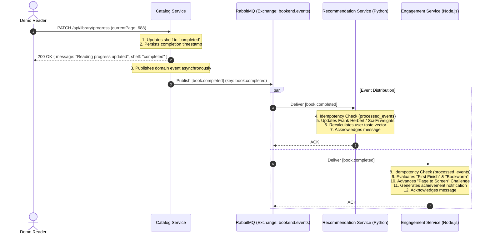

# Bookend — Distributed Microservices Architecture & System Design

This document details the architectural principles, domain decomposition, data ownership models, communication protocols, and operational trade-offs underpinning **Bookend**. It is specifically structured to support University Backend Development presentations, system design reviews, and technical interview discussions.

---

## 1. System Topology & Architecture Diagram

```mermaid
flowchart TD
    subgraph ClientLayer ["Client Layer"]
        UI["React 19 + TypeScript + Vite SPA<br/>(Port 3000)"]
    end

    subgraph GatewayLayer ["Gateway & Routing Layer"]
        GW["API Gateway<br/>(Node.js + Express | Port 4000)<br/>• Correlation IDs (x-request-id)<br/>• Route Forwarding<br/>• Health Aggregator (/api/health/all)<br/>• Failover Buffers"]
    end

    subgraph ServicesLayer ["Domain Microservices Layer"]
        IS["Identity Service<br/>(Node.js | Port 4001)<br/>• DB: identity.db<br/>• Auth & JWT Tokens<br/>• Reader Profiles"]
        CS["Catalog & Reading Service<br/>(Node.js | Port 4002)<br/>• DB: catalog.db<br/>• Books, Adaptations, Shelves<br/>• Event Publisher"]
        SS["Social Service (StoryLab)<br/>(Node.js | Port 4003)<br/>• DB: social.db<br/>• Theories, Pitches, Comments<br/>• Event Publisher"]
        RS["Recommendation Service (NextRead)<br/>(Python + FastAPI | Port 4004)<br/>• DB: recommendations.db<br/>• Taste Vectors & ShelfMatch<br/>• Event Consumer"]
        ES["Engagement Service (ReadQuest)<br/>(Node.js | Port 4005)<br/>• DB: engagement.db<br/>• Streaks, Challenges, Badges<br/>• Event Consumer"]
    end

    subgraph MessagingLayer ["Asynchronous Message Broker"]
        RMQ["RabbitMQ Event Broker<br/>(AMQP 5672 | Management 15672)<br/>Topic Exchange: bookend.events"]
    end

    %% Client to Gateway
    UI -->|HTTP / REST (JSON)| GW

    %% Gateway to Services (Synchronous Routing)
    GW -->|/api/auth, /api/users| IS
    GW -->|/api/books, /api/adaptations, /api/library| CS
    GW -->|/api/storylab| SS
    GW -->|/api/recommendations, /api/shelfmatch| RS
    GW -->|/api/readquest, /api/notifications| ES

    %% Event Publishing
    CS -.->|Publishes: book.completed, book.rated, reading.progress.updated| RMQ
    SS -.->|Publishes: story.published, story.liked| RMQ

    %% Event Consumption
    RMQ -.->|Consumes: book.completed, book.rated| RS
    RMQ -.->|Consumes: book.completed, story.published, adaptation.voted| ES
```

---

## 2. Service Decomposition & Data Ownership

To achieve **high cohesion** and **low coupling**, Bookend enforces strict data ownership boundaries. Services **never** directly access or mutate another service's database tables. All cross-boundary synchronization occurs through REST contracts or asynchronous event streams.

| Service | Business Capability | Storage Boundary | Synchronous Ingress (REST) | Event Responsibilities |
| :--- | :--- | :--- | :--- | :--- |
| **API Gateway** | Request aggregation, tracing, routing, resilience | None (Stateless) | Port 4000: `/api/*`, `/health`, `/api/health/all` | Propagates `x-request-id` headers |
| **Identity Service** | User registration, password hashing (`bcrypt`), JWT issuance, reader profiles | `data/identity.db` (`users` table) | Port 4001: `/api/auth/register`, `/login`, `/me`, `/users` | None (Decoupled auth authority) |
| **Catalog & Reading Service** | Book catalog, page-to-screen adaptations, user library shelves, ratings & reviews | `data/catalog.db` (`books`, `adaptations`, `adaptation_votes`, `user_library`, `ratings_reviews`) | Port 4002: `/api/books`, `/api/adaptations`, `/api/library`, `/api/ratings` | **Publisher**: `book.completed`, `book.rated`, `reading.progress.updated`, `adaptation.voted` |
| **Social Service (StoryLab)** | Transformative creative community, sequel ideas, alternate endings, fan pitches, likes, comments, bookmarking | `data/social.db` (`storylab_posts`, `storylab_likes`, `storylab_comments`, `storylab_bookmarks`) | Port 4003: `/api/storylab`, `/api/storylab/:id/like`, `/comments` | **Publisher**: `story.published`, `story.liked` |
| **Recommendation Service (NextRead)** | Mathematical taste vector computation, content similarity, ShelfMatch compatibility scoring | `data/recommendations.db` (`user_taste_profiles`, `processed_events`) | Port 4004: `/api/recommendations`, `/api/shelfmatch` | **Consumer**: `book.completed`, `book.rated`, `reading.progress.updated` |
| **Engagement Service (ReadQuest)** | Gamified reading goals, reading streaks, challenges, achievements, notifications | `data/engagement.db` (`challenges`, `user_challenge_progress`, `achievements`, `notifications`, `processed_events`) | Port 4005: `/api/readquest/dashboard`, `/challenges`, `/notifications` | **Consumer**: `book.completed`, `book.rated`, `story.published`, `adaptation.voted` |

---

## 3. Synchronous REST vs Asynchronous Messaging

Bookend avoids the common anti-pattern of using synchronous REST calls for background mutations.

### The Decision Rule
- **Use REST** when the client requires an immediate response (querying book synopsis, authenticating, viewing recommendations).
- **Use Messaging (RabbitMQ)** when a state change in one domain needs to trigger downstream side effects without blocking the initiating user.

```
+-------------------------------------------------------------------------------+
| SYNCHRONOUS REST                               ASYNCHRONOUS RABBITMQ (AMQP)   |
| • Client-facing queries                        • Domain events (past-tense)   |
| • Immediate return value required              • Decoupled background work    |
| • Short transaction lifecycle                  • Buffering & retry resilience |
| • Direct request/response                      • One-to-many event broadcast  |
+-------------------------------------------------------------------------------+
```

### Detailed Interaction Matrix

| Interaction | Protocol | Producer | Consumer(s) | Architectural Justification |
| :--- | :--- | :--- | :--- | :--- |
| **User Sign-In** | REST (HTTP POST) | Frontend | Identity Service | Immediate authentication token required to permit application access. |
| **Fetch Book Catalog** | REST (HTTP GET) | Frontend | Catalog Service | Immediate data needed to render UI book grid and metadata filters. |
| **Book Completed** | RabbitMQ (`book.completed`) | Catalog Service | Recommendation Service, Engagement Service | The user request completes once the library shelf is updated. Downstream taste recalculation and achievement rule evaluation happen asynchronously in the background. |
| **Book Rated (1-5★)** | RabbitMQ (`book.rated`) | Catalog Service | Recommendation Service, Engagement Service | Rating updates user taste vectors and advances "Critical Eye" achievement without blocking review submission. |
| **StoryLab Published** | RabbitMQ (`story.published`) | Social Service | Engagement Service | Unlocks "StoryLab Pioneer" badge and notifies subscribers asynchronously. |
| **Fetch Recommendations** | REST (HTTP GET) | Frontend | Recommendation Service | User navigating to NextRead expects personalized recommendations computed from current taste state. |
| **ShelfMatch Calculation**| REST (HTTP GET) | Frontend | Recommendation Service | User requesting reader compatibility expects immediate on-screen percentage calculation. |

---

## 4. End-to-End Event Trace: `book.completed`

Below is the execution flow when a reader marks *Dune* completed:



### Event Payload Schema
```json
{
  "eventId": "evt_1700000000000_a1b2c3d4",
  "eventType": "book.completed",
  "occurredAt": "2026-11-21T10:45:00.000Z",
  "payload": {
    "userId": "user_elena_vance",
    "bookId": "book_dune",
    "title": "Dune",
    "author": "Frank Herbert",
    "genres": ["Science Fiction", "Space Opera", "Classics"],
    "pageCount": 688,
    "rating": 5,
    "completedAt": "2026-11-21T10:45:00.000Z"
  }
}
```

---

## 5. Strict Idempotency & Fault Isolation

### Why Idempotency is Critical
Distributed brokers like RabbitMQ guarantee **at-least-once delivery**. Network partitions, consumer crashes before ACK, or client retries can cause the same message to be redelivered.

Without idempotency:
- A user completing a book could trigger duplicate achievement notifications.
- Challenge counters could increment by 2 instead of 1.
- Recommendation taste weights would become skewed.

### Implementation Pattern
Both Recommendation and Engagement services implement a **Transactional Deduplication Table**:

```sql
CREATE TABLE IF NOT EXISTS processed_events (
  event_id TEXT PRIMARY KEY,
  event_type TEXT NOT NULL,
  processed_at DATETIME DEFAULT CURRENT_TIMESTAMP
);
```

When an event arrives:
1. `SELECT 1 FROM processed_events WHERE event_id = ?`
2. If row exists: Log `[IDEMPOTENT SKIP]`, acknowledge message to RabbitMQ, and terminate processing.
3. If row does not exist: Execute domain logic (unlock achievements, update taste vectors), insert `event_id`, and acknowledge message.

### Fault Isolation & Graceful Degradation
- **If Recommendation Service crashes**: Readers can still log in, explore books, update their library, rate titles, and write StoryLab posts. RabbitMQ buffers unconsumed events in `recommendation-events-queue`. Once the service restarts, it consumes all pending events without data loss.
- **If RabbitMQ is temporarily offline during cold boot**: Outgoing events are buffered in memory and in the service outbox. HTTP fallback dispatch ensures local end-to-end development is never blocked.

---

## 6. Architectural Trade-offs & Operational Costs

A mature engineering discussion acknowledges that **microservices are not universally superior to monoliths**.

### Benefits Demonstrated by Bookend
1. **Technology Flexibility**: The Recommendation Service utilizes Python, FastAPI, and Scikit-Learn for vector math and cosine similarity, while the Catalog and Social services utilize Node.js and Express for high-concurrency I/O.
2. **Fault Isolation**: A memory leak or slow mathematical calculation in the Recommendation Service cannot take down the Identity Service or Catalog database.
3. **Independent Scalability**: The Catalog service (high read volume) can be horizontally scaled with multiple container instances independently of the Engagement service.
4. **Autonomous Domain Ownership**: Each service owns its database and schema migrations without coordination deadlocks.

### Operational Costs Incurred
1. **Network Latency & Serialization Overhead**: Instead of in-memory function calls, inter-service interactions traverse HTTP/TCP or AMQP, introducing network serialization costs.
2. **Distributed Debugging**: Diagnosing a bug across 5 services requires correlation tracking (`x-request-id`), distributed logging, and health aggregation.
3. **Infrastructure Complexity**: Running Bookend requires container orchestration (Docker Compose), a message broker (RabbitMQ), and multiple database files/instances.
4. **Eventual Consistency**: After completing a book, recommendations update within milliseconds via RabbitMQ, but this is eventually consistent rather than ACID transactional.

> **University Defense Note**: For a very small MVP with a single developer, a modular monolith would be simpler to deploy and debug. Bookend intentionally adopts this microservices decomposition to demonstrate distributed event handling, domain boundaries, and asynchronous message brokering at production portfolio quality.
